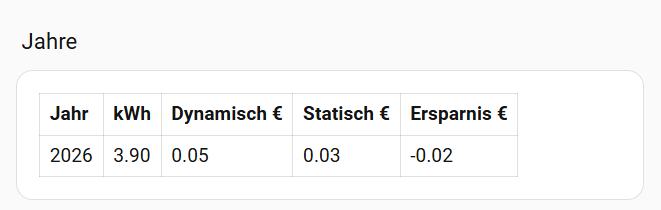

# ha_dynamic_tariff_auditor

Home-Assistant-Integration, die einen **dynamischen Stromtarif** (Tibber, aWATTar o. Ä.) über einen
Zeitraum gegen einen **statischen Tarif** (Grundpreis + Arbeitspreis) vergleicht. Mehrere statische
Gültigkeitszeiträume werden unterstützt. Die Auswertung läuft live und historisch: beim Erstlauf
werden die Stunden-Statistiken aus der Datenbank nachberechnet.

## Funktionen

- Config-Flow: dynamischer Tarif (Zähler, Börsenpreis-Sensor, Faktor, Aufschlag, Grundpreis) und beliebig viele statische Zeiträume
- Historische Auswertung ab einem frei wählbaren Datum: Stunden-Mittelwerte der Leistung aus der Langzeit-Statistik (dauerhaft in der DB), danach der Zustandsverlauf
- Verbrauch: bei Leistung Stundenmittel im Erstlauf bzw. Zeitintegration, bei Zählern Stundendifferenz im Erstlauf bzw. Zählerdifferenz
- Live-Auswertung über Zustandsänderungen, Zwischenstand wird gespeichert
- Sensoren: Kosten dynamisch / statisch, Ersparnis (€ und %), Verbrauch, Ø-Preise (ct/kWh)
- Attribut `zeitraeume` am Sensor „Ersparnis dynamisch“: Aufschlüsselung je statischem Zeitraum
- Binärsensor „Dynamisch günstiger“

## Voraussetzungen

- Netzbezug-Sensor, automatisch erkannt an der Einheit:
  - Leistung in W oder kW (`state_class: measurement`): Verbrauch = Leistung × Zeit. Negative Werte (Einspeisung) zählen nicht.
  - Zähler in Wh, kWh oder MWh (`state_class: total_increasing`): Verbrauch = Zählerdifferenz
- Börsenpreis-Sensor mit `state_class: measurement` (sonst gibt es keine Stunden-Statistik)
- Recorder aktiv. Für Auswertungen über Monate sollte `purge_keep_days` nicht zu klein sein, weil nur der Zeitraum seit dem letzten Stand aus den Zuständen gelesen wird. Die Stunden-Statistik bleibt dauerhaft erhalten.

## Installation

1. Ordner `custom_components/ha_dynamic_tariff_auditor/` nach `config/custom_components/` kopieren.
2. Home Assistant neu starten.
3. Einstellungen → Geräte & Dienste → Integration hinzufügen → „Dynamic Tariff Auditor“.

## Preise eingeben

### Statische Tarife
Im Config-Flow je Zeitraum: Bezeichnung, gültig ab, gültig bis (optional), Grundpreis (€/Monat), Arbeitspreis (ct/kWh, brutto). Für einen Preiswechsel einen weiteren Zeitraum anlegen. Eine Optionsseite dafür gibt es noch nicht.

### Dynamischer Tarif
Der Preis wird aus dem Sensor so berechnet:

    Preis = Spotpreis × Faktor + Aufschlag

- **Tibber:** Der Tibber-Preissensor liefert meist den Gesamtpreis brutto. Faktor `1,0`, Aufschlag `0`.
- **aWATTar:** Der Sensor liefert oft den Börsenpreis netto. Faktor `1,19` (Mehrwertsteuer), Aufschlag = Netzentgelte, Abgaben und Anbieterpreis in ct/kWh.

Den Abgleich macht man am besten mit der Stromrechnung. Stimmt der Betrag nicht, passt meist Faktor oder Aufschlag nicht.

## Dashboard-Beispiel

Die Ansicht „Tarif“ mit Gesamtkosten, laufendem Monat, Arbeitspreisen sowie Monats- und Jahrestabelle liegt als YAML unter [`docs/dashboard-tarif.yaml`](docs/dashboard-tarif.yaml). Die Entitäts-IDs gelten für einen Eintrag namens „Tarifvergleich“ und müssen bei dir eventuell angepasst werden.

*Hinweis: Die Screenshots stammen von Version 0.3.2. Die Werte aus dieser Version sind teilweise fehlerhaft (siehe Changelog 0.3.3). Aktuelle Screenshots folgen.*

Einbinden: Dashboard „Home“ → Bearbeiten → Ansicht hinzufügen, dann den Inhalt der YAML-Datei übernehmen (Ansicht als YAML bearbeiten).

## Entwicklung und Tests

    pip install pytest
    python -m pytest tests

Die Tests prüfen die reine Berechnungslogik in `calc.py` ohne Home Assistant.

## Bekannte Einschränkungen

- Preise und Leistung aus der Statistik sind Stundenmittel. Bei 15-Minuten-Preisen geht Auflösung verloren.
- Der Zustandsverlauf reicht nur so weit wie der Recorder. Ist HA länger aus als `purge_keep_days`, fehlt der Zeitraum.
- Bei Leistungssensoren hängt die Genauigkeit davon ab, wie oft der Sensor aktualisiert.
- Tarife lassen sich nach dem Anlegen nicht ändern (keine Optionsseite).
- Die Grundgebühr wird anteilig nach Sekunden berechnet, 1 Monat = 30,4375 Tage.
- Noch nicht in einer echten Home-Assistant-Instanz getestet.

## Lizenz

Privat, keine Lizenz.
