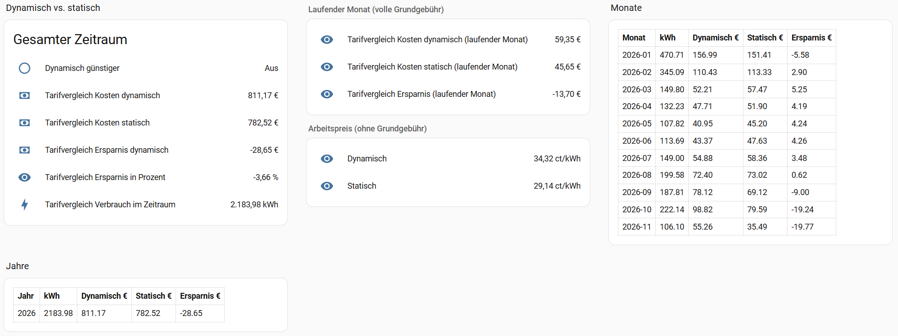
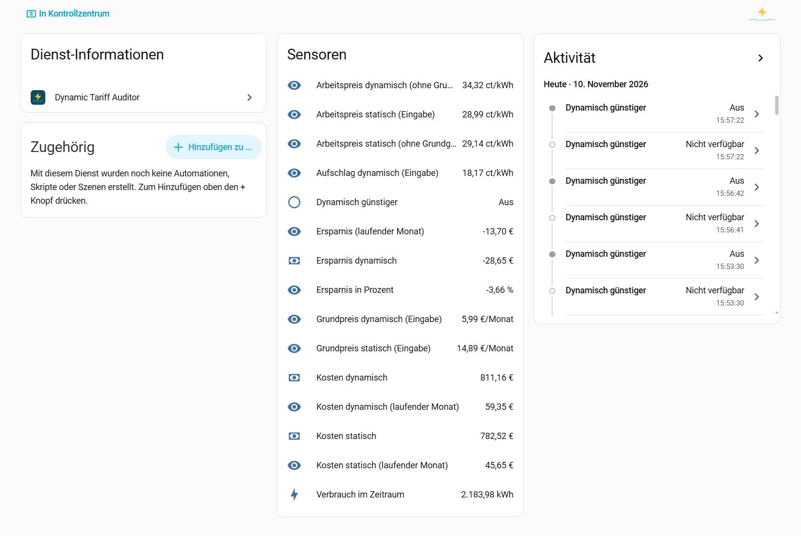

# ha_dynamic_tariff_auditor

Home-Assistant-Integration, die einen **dynamischen Stromtarif** (Tibber, aWATTar o. Ä.) über einen
Zeitraum gegen einen oder mehrere **statische Tarife** (Grundpreis + Arbeitspreis) vergleicht.
Die Auswertung läuft live und historisch: Der Erstlauf rechnet ab einem frei wählbaren Datum nach,
danach läuft sie mit den Zustandsänderungen weiter.

## Funktionen

- **Tarifbibliothek:** statische Tarife anlegen, ändern und löschen. Änderungen wirken auf alle Einträge, die den Tarif nutzen.
- **Zuweisungen:** Jeder Eintrag bekommt einen oder mehrere Tarife mit eigenem Gültigkeitszeitraum. Die Zeiträume dürfen sich nicht überschneiden.
- **Dynamischer Tarif:** Börsenpreis-Sensor, Faktor (z. B. MwSt.), Aufschlag, Grundpreis.
- **Auswertungszeitraum:** Beginn und optionales Ende.
- **Historie:** Erstlauf aus der Langzeit-Statistik des Recorders, danach aus dem Zustandsverlauf.
- **Preisimport:** Börsenpreise aus SMARD-CSV oder direkt von der Energy-Charts-API (DE-LU) für einen Zeitraum.
- **Sensoren:** Kosten dynamisch und statisch, Ersparnis in € und %, Verbrauch, Ø-Arbeitspreise (ct/kWh, ohne Grundgebühr).
- **Monats- und Jahreswerte:** als Attribute `monate` und `jahre` am Sensor „Kosten dynamisch“, inklusive anteiliger Grundgebühr.
- **Laufender Monat:** eigene Sensoren mit der vollen Grundgebühr des Monats.
- **Binärsensor** „Dynamisch günstiger“.

## Voraussetzungen

- **Netzbezug-Sensor**, Einheit wird automatisch erkannt:
  - Leistung in W oder kW (`state_class: measurement`): Verbrauch = Leistung × Zeit. Negative Werte (Einspeisung) zählen nicht.
  - Zähler in Wh, kWh oder MWh (`state_class: total_increasing`): Verbrauch = Zählerdifferenz.
- **Börsenpreis-Sensor** mit `state_class: measurement`. Die Einheit (ct/kWh, €/kWh, €/MWh) wird ebenfalls erkannt.
- **Recorder** aktiv. Für Auswertungen über Monate sollte `purge_keep_days` nicht zu klein sein. Die Stunden-Statistik bleibt dauerhaft erhalten.

## Installation

1. Ordner `custom_components/ha_dynamic_tariff_auditor/` nach `config/custom_components/` kopieren (oder über HACS als benutzerdefiniertes Repository einbinden).
2. Home Assistant neu starten.
3. Einstellungen → Geräte & Dienste → Integration hinzufügen → „Dynamic Tariff Auditor“.

## Einrichtung

1. **Dynamischer Tarif:** Verbrauchssensor, Börsenpreis-Sensor, Grundpreis, Faktor, Aufschlag, Auswertung ab (optional bis).
2. **Statische Tarife zuweisen:** einen Tarif aus der Bibliothek wählen oder neu anlegen, dazu Gültig ab und Gültig bis (optional). Mit „Weiteren Tarif zuweisen“ kommen weitere Zeiträume dazu.

Nachträglich unter **Konfigurieren** möglich:

- Eingegebene Werte anzeigen
- Dynamischen Tarif ändern
- Statischen Tarif zuweisen oder Zuweisung entfernen
- Tarif in der Bibliothek anlegen, ändern oder löschen

Ein Tarif lässt sich nur löschen, wenn kein Eintrag ihn mehr nutzt.

### Dynamischer Tarif

Der Preis wird aus dem Börsenpreis so berechnet:

    Preis = Spotpreis × Faktor + Aufschlag

Vorbelegt sind Faktor **1,19** und Aufschlag **18 ct/kWh**.

- **Faktor:** 1,19, wenn der Börsenpreis netto ist (MwSt. 19 %). Ist der Sensor schon brutto (z. B. Tibber-Gesamtpreis), 1,0 eintragen.
- **Aufschlag:** typisch **16–20 ct/kWh** je nach Anbieter und Netzbetreiber (Netzentgelte, Umlagen, Anbieteraufschlag). Die genaue Höhe steht auf der Stromrechnung.
- **Tibber:** meist Faktor `1,0`, Aufschlag `0`.
- **aWATTar:** Faktor `1,19`, Aufschlag = Netzentgelte, Abgaben und Anbieterpreis.

Den Abgleich macht man am besten mit der Stromrechnung. Stimmt der Betrag nicht, passt meist Faktor oder Aufschlag nicht.

## Börsenpreise importieren

Fehlt die Preis-Historie, lassen sich Börsenpreise für einen Zeitraum nachladen. Die Preise landen in der Speicherdatei der Integration (`.storage/ha_dynamic_tariff_auditor.prices`).

**Energy-Charts (empfohlen):** Dienst `ha_dynamic_tariff_auditor.import_energy_charts_prices`

```yaml
service: ha_dynamic_tariff_auditor.import_energy_charts_prices
data:
  start: "2025-01-01"
  end: "2025-12-31"
```

`end` ist optional (Standard: heute). Die Abfrage läuft in Blöcken von 92 Tagen mit Pause; bei HTTP 429 wird wiederholt.

**SMARD:** Dienst `ha_dynamic_tariff_auditor.import_smard_prices` mit einer CSV-Datei (Großhandelspreise DE/LU, €/MWh). Die Datei auf dem HA-Host ablegen, z. B. unter `/config/www/smard.csv`, und den Pfad als `file` angeben.

Nach einem Import wird die Auswertung ab Auswertungsbeginn neu berechnet.

## Dashboard-Beispiel

Die Ansicht „Tarif“ mit Gesamtkosten, laufendem Monat, Arbeitspreisen sowie Monats- und Jahrestabelle liegt als YAML unter [`docs/dashboard-tarif.yaml`](docs/dashboard-tarif.yaml). Die Entitäts-IDs gelten für einen Eintrag namens „Tarifvergleich“ und müssen bei dir eventuell angepasst werden.





Einbinden: Dashboard „Home“ → Bearbeiten → Ansicht hinzufügen, dann den Inhalt der YAML-Datei übernehmen (Ansicht als YAML bearbeiten).

## Entwicklung und Tests

    pip install pytest
    python -m pytest tests

Die Tests prüfen die Berechnung in `calc.py` ohne Home Assistant.

## Bekannte Einschränkungen

- Preise und Leistung aus der Statistik sind Stundenmittel. Bei 15-Minuten-Preisen geht Auflösung verloren.
- Der Zustandsverlauf reicht nur so weit wie der Recorder. Ist HA länger aus als `purge_keep_days`, fehlt der Zeitraum.
- Bei Leistungssensoren hängt die Genauigkeit davon ab, wie oft der Sensor aktualisiert.
- Die Grundgebühr wird anteilig nach Sekunden berechnet, 1 Monat = 30,4375 Tage.
- Zeiträume ohne Tarif oder ohne Börsenpreis zählen auf keiner Seite. Dafür braucht es vollständige Tarif- und Preisdaten.
- Die Monatssensoren „laufender Monat“ und die Eingabe-Sensoren beziehen sich immer auf den heutigen Tag.

## Lizenz

MIT-Lizenz, siehe [LICENSE](LICENSE). Copyright (c) 2026 A. Kofort.
